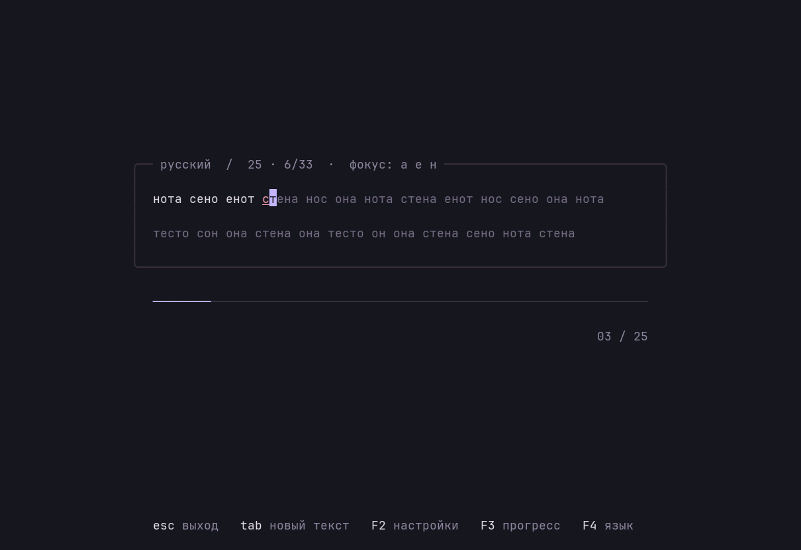
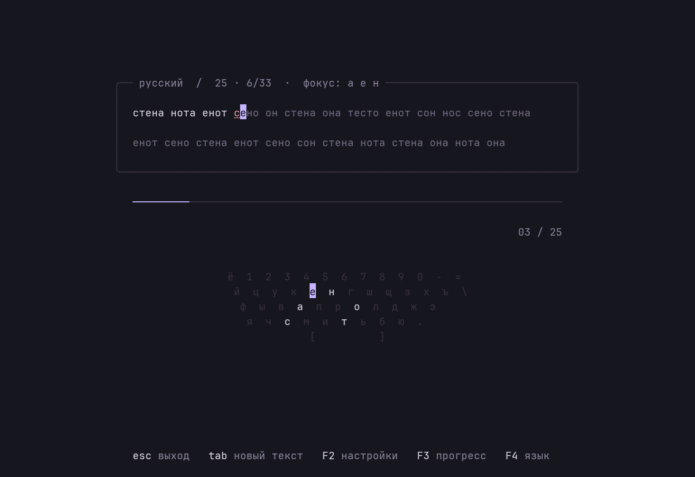
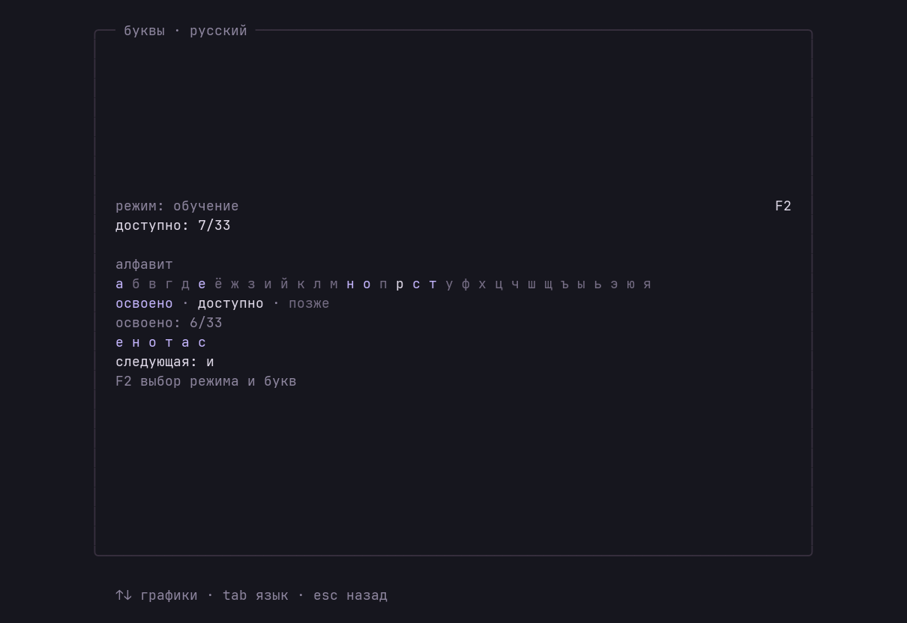
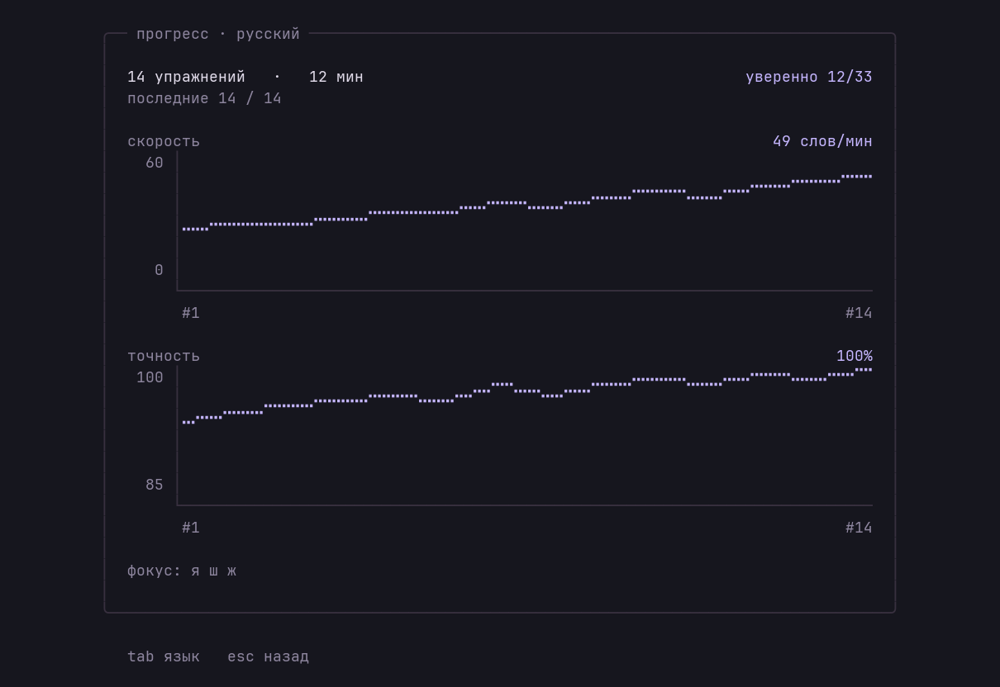

# Тренажёр печати

Минималистичный TUI для практики печати на русском и английском.



Текст в тонкой рамке, тёмный фон и мягкая подсветка ошибок. Набранные буквы
светлеют, текущая буква выделяется лавандовым курсором. Скорость и точность
появляются после завершения упражнения.

## Запуск

Нужны **Python 3.10+**, модуль `curses` и терминал с UTF-8 на Linux или macOS.
Внешних зависимостей нет. Скачайте репозиторий и запустите тренажёр:

```sh
git clone https://github.com/butukay/stuk.git
cd stuk
./stuk
```

При первом запуске — 25 слов и постепенное открытие букв. Можно выбрать язык,
длину и режим:

```sh
./stuk --lang en
./stuk --words 50
./stuk --mode free
./stuk --lang en --letters asdfjkl
./stuk --help
```

Длина упражнения — от 1 до 60 слов. Команда запуска работает из любой папки,
если указать путь к файлу `stuk`.

Для установки команды `stuk`, доступной из любой папки:

```sh
python3 -m venv "$HOME/.local/share/stuk/app"
"$HOME/.local/share/stuk/app/bin/python" -m pip install .
mkdir -p "$HOME/.local/bin"
ln -sf "$HOME/.local/share/stuk/app/bin/stuk" "$HOME/.local/bin/stuk"
stuk
```

Папка `~/.local/bin` должна быть в `PATH`. Установленная копия использует
системный Python и работает независимо от исходников. Для обновления повторите
команду `pip install .` из папки проекта.

## Управление

| Клавиша | Действие |
| --- | --- |
| `Esc` или `Ctrl+C` | Выйти |
| `Tab` | Новый текст |
| `F2` или `Ctrl+O` | Открыть / закрыть настройки |
| `F3` или `Ctrl+P` | Открыть / закрыть прогресс и графики |
| `F4` или `Ctrl+L` | Переключить русский / английский и начать новый текст |
| Печатать | Начать упражнение; таймер запустится с первой буквы |
| `Backspace` | Исправить предыдущую букву |
| `Ctrl+W` | Удалить предыдущее слово |
| `Ctrl+K` | Показать / скрыть клавиатуру |
| `Enter` после завершения | Следующее упражнение |

Подсказки внизу упражнения расположены в порядке `Esc`, `Tab`, `F2`, `F3`, `F4`.
На экране прогресса `F4` меняет язык просмотра; текущая тренировка сохраняется.
В редакторе букв можно переключаться через `F4`: черновики RU/EN сохраняются
до применения или отмены редактирования.

В настройках `Esc` возвращает к упражнению. Стрелки `↑↓` выбирают строку,
`←→` или `Enter` меняют значение. Доступны режим, свои буквы, адаптация, палитра, клавиатура, язык и
длина упражнения — 10, 25 или 50 слов; произвольная длина задаётся через `--words`.
Таймер приостанавливается в настройках, на экране прогресса и при слишком маленьком окне.

## Клавиатура и настройки

Клавиатура скрыта по умолчанию. Включите её в настройках — будет видна
раскладка выбранного языка с подсветкой следующей клавиши, включая пробел.



Для клавиатуры нужно окно от 46 × 22. Если уменьшить окно, клавиатура временно
скрывается; выбранная настройка сохраняется.

Изменения сохраняются в `$XDG_CONFIG_HOME/stuk/settings.json` или
`~/.config/stuk/settings.json`. Параметры командной строки имеют приоритет
при запуске. Повреждённые значения настроек игнорируются.
Для сброса настроек удалите этот файл. История упражнений хранится отдельно.

Ошибочная буква не блокирует ввод. Её можно исправить, пока упражнение
не завершено; точность учитывает и исправленные ошибки. Скорость считается
по правильным символам: пять символов — одно условное слово.

Интерфейс подстраивается под размер окна и держит курсор в поле зрения.
Минимальный размер — 32 × 12; в меньшем окне ввод текста приостановлен.
Для полной палитры нужен терминал с 256 цветами, например с
`TERM=xterm-256color`. В остальных терминалах используются базовые цвета
или монохромный режим.

Все слова встроены. Приложение работает офлайн.

## Раскладка ввода

Печатать можно с русской или английской раскладкой: ввод сопоставляется
с физическими клавишами выбранного языка тренировки. Например, `ghbdtn`
засчитывается как `привет` в русском упражнении, а `руддщ` — как `hello`
в английском. Это работает и в редакторе своих букв.

Учитываются клавиши `ё`, `х`, `ъ`, `ж`, `э`, `б`, `ю` и их английские знаки.
Регистр сохраняется: `Shift` и `Caps Lock` по-прежнему влияют на правильность
ввода. Сопоставление не зависит от ожидаемой буквы, поэтому неверная клавиша
остаётся ошибкой. Горячие клавиши обрабатываются отдельно.

Используются стандартные QWERTY и ЙЦУКЕН. Терминал передаёт символы, поэтому
знаки вроде `.` в русском упражнении трактуются как клавиши `ю` английской
раскладки.

## Адаптивная практика

Адаптация включена по умолчанию; её можно отключить в `F2 → адаптивный текст`
или через `"adaptive": false` в настройках. Фокус включает новые, ещё не уверенные
буквы, а также буквы с ошибками или задержками. До трёх целевых букв показаны
в заголовке как `фокус`.

Следующий текст чаще содержит эти буквы, включая редкие. Не менее 35% слов
по-прежнему выбираются обычным способом, с учётом выбранного набора букв.
Соседние повторы избегаются, когда в наборе есть несколько подходящих слов.
Анализ учитывает последние 30 завершённых упражнений выбранного языка,
поэтому старые ошибки постепенно перестают влиять на подбор. Исправленные
ошибки тоже учитываются. Длинные остановки и время в меню исключены из оценки
задержек между буквами.

После упражнения видны его номер и число уверенных букв. При достаточной
истории добавляется сравнение скорости со средним по последним пяти упражнениям
того же языка и длины либо отметка личного рекорда. Сравнение начинается после
трёх предыдущих упражнений; рекорд требует точности не ниже 90%.

Буква считается уверенной после 12 попыток с точностью от 97%, если есть хотя бы
пять измеренных интервалов со средним не больше 0,5 с. Счётчик показывает текущую
уверенность за последние 30 упражнений: 33 буквы для русского, 26 для английского.

## Постепенное открытие и выбор практики

По умолчанию выбран режим **по этапам** (`guided`). Начало — шесть букв:
`е н о т а с` для русского и `e n i r a t` для английского. Текст содержит только
доступные буквы. Для каждого этапа есть настоящие слова; новая буква получает
дополнительные повторения.

Когда все доступные буквы хотя бы раз достигли описанного выше порога уверенности,
открывается следующая. После упражнения появляется сообщение об открытии.
Заработанные буквы остаются освоенными и открытыми, даже если следующие
упражнения получатся хуже. Вся прежняя история тоже учитывается.

В `F2 → режим` можно в любой момент выбрать:

- **По этапам** (`guided`): постепенное открытие букв.
- **Все буквы** (`free`): весь алфавит с первого упражнения.
- **Свои буквы** (`custom`): только выбранный вами набор.

`F2 → свои буквы → Enter` открывает редактор. `Ctrl+U` очищает поле, `Enter`
применяет набор и включает свой режим, `Esc` отменяет редактирование. Наборы
для RU/EN сохраняются отдельно. Достаточно одной буквы; повторы и посторонние
символы удаляются. Если слов для всего выбранного набора нет, явно включается
буквенное упражнение. Оно по-прежнему использует только ваши буквы.

Свободные и собственные упражнения засчитываются в освоение этапов.
Отключение адаптации убирает усиленный подбор слабых букв, сохраняя выбранный режим.
Через CLI: `--mode guided|free|custom`; `--letters` задаёт свой набор и имеет
приоритет над `--mode` для текущего запуска.

## Прогресс и графики

Нажмите `F3` или `Ctrl+P`: откроются графики **скорости** и **точности**,
число упражнений, время практики, уверенные буквы и текущий фокус. `Tab` или
`←→` переключают русский / английский; язык самой тренировки остаётся прежним.
`Esc` возвращает к тексту, сохраняя место и исключая время просмотра из таймера.
`↑/↓` переключают графики и экран букв; также доступны `L` для букв и `G` для графиков.

На экране букв видны освоенные буквы, набор, доступный для текущего режима,
и следующая буква по этапам. Освоение здесь — постоянный результат, а счётчик
уверенности у графиков отражает последние 30 упражнений.





На снимках — демонстрационная история из временного профиля. В вашем профиле
данные появятся после первого завершённого упражнения. Графики показывают
последние 30 упражнений каждого языка; по горизонтали — их номера. На полном
экране шкала точности приближается к диапазону ваших результатов, и её границы
подписаны. В маленьком окне используются компактные графики со шкалой 0–100%.

Вся история сохраняется в `$XDG_DATA_HOME/stuk/history.json` или
`~/.local/share/stuk/history.json`. В неё попадают только завершённые упражнения,
по одному разу. Прерванные через `Tab`, смену языка или выход не учитываются.
Хранятся результаты и агрегаты по буквам; сам набранный текст не сохраняется.
Для резервной копии достаточно скопировать файл истории.

Запись атомарная и защищена от одновременного запуска нескольких экземпляров.
При ошибке сохранения появляется предупреждение; приложение повторяет запись
при следующем завершении, открытии прогресса и выходе. До успешной записи данные
доступны в текущем запуске. Повреждённый файл автоматически не перезаписывается.

## Цвета

По умолчанию используется **Graphite Lavender**: фон `#16161e`, текст `#e1dbea`
и лавандовый акцент `#c4b5fd`.
В `F2 → палитра` доступны `lavender`, `terminal` (цвета вашего терминала)
и `warm` (песочная палитра). Переключение применяется сразу.

Свои цвета задаются в секции `colors` файла настроек. Можно переопределить
только нужные роли; остальные берутся из выбранной палитры:

```json
{
  "language": "en",
  "words": 25,
  "show_keyboard": true,
  "adaptive": true,
  "practice_mode": "guided",
  "custom_letters": {"ru": "енотас", "en": "enirat"},
  "theme": "lavender",
  "colors": {
    "accent": "#c4b5fd",
    "error": "#ed9aaa"
  }
}
```

| Поле в `colors` | Назначение |
| --- | --- |
| `background` | Фон приложения |
| `foreground` | Правильно набранные буквы и основной текст |
| `pending` | Ещё не набранные буквы |
| `muted` | Подписи и клавиатура |
| `border` | Рамка и неактивная часть прогресса |
| `accent` | Курсор, активная клавиша, выбор и прогресс |
| `error` | Ошибки |
| `cursor_text` | Буква на фоне курсора |

Поддерживаются `#RRGGBB`, индексы ANSI/xterm `0–255` и строка `"default"`
для цвета терминала. Например, `"background": "default"` сохраняет его
исходный фон, включая прозрачность. Явные `colors` имеют приоритет над
палитрой; для сброса переопределений оставьте `"colors": {}`.
После ручного редактирования файла перезапустите приложение.

Полный пример: [examples/settings.json](examples/settings.json).
Точные RGB используются, когда терминал поддерживает direct color или
изменяемую палитру; иначе выбирается ближайший доступный цвет.

## Разработка

```sh
PYTHONPATH=src python3 -m stuk
PYTHONPATH=src python3 -m unittest discover -s tests -v
python3 -m compileall -q src tests
```

Форматирование и статические проверки — через Ruff (только для разработки):

```sh
.venv/bin/python -m pip install '.[dev]'
.venv/bin/ruff format src tests
.venv/bin/ruff check src tests
```

Исходники находятся в `src/stuk/`: `session.py` отвечает за ввод и результаты,
`words.py` — за словари, `layout.py` — за переносы и расположение текста,
`tui.py` — за экран и настройки, `keyboard.py` — за раскладки,
`settings.py` — за сохранение настроек, `theme.py` и `palette.py` — за цвета,
`adaptive.py` — за подбор слов, `curriculum.py` — за открытие букв,
`history.py` — за историю, `charts.py`, `progress.py` и `letters.py` — за прогресс,
`cli.py` — за параметры запуска.
Тесты используют только стандартную библиотеку, включая проверки настоящего
приложения через PTY.

Вдохновение: [btyper](https://github.com/Ada-lave/btyper). Код и словари stuk
написаны независимо.
